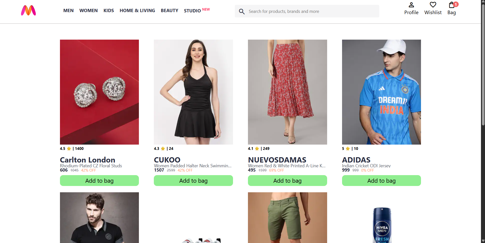
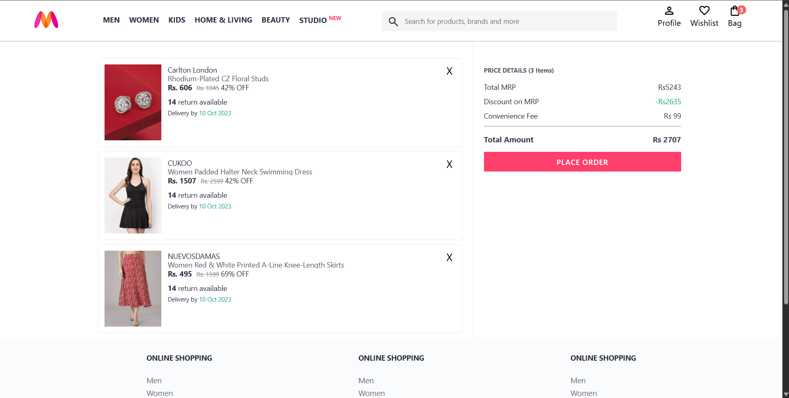

 Myntra Functional Clone

A functional clone of the popular e‑commerce platform Myntra, built using HTML, CSS, and JavaScript. This project replicates core features of an online shopping site, including product listings, search functionality, cart management, and responsive design.

 Live Demo: [Myntra Functional Clone ](https://argha0508.github.io/Myntra_Functional_JS_Clone/)(argha0508.github.io in Bing)

 Features:

i. Homepage with product categories (Men, Women, Kids, Accessories, etc.)

ii. Search bar with functional icons (search, profile, cart, wishlist)

iii. Product listing pages with images, prices, and descriptions

iv. Add to Cart & Wishlist functionality

v. Bag/Cart Section

vi. Displays items added to the cart

vii. Shows product details, quantity, and total price

viii. Remove items from the cart dynamically

ix. Responsive design for desktop and mobile

x. Clean UI inspired by Myntra’s design language

 Technologies Used:

i. HTML5 → Page structure and semantic layout

ii. CSS3 → Styling, grid/flexbox layouts, responsive design

iii. JavaScript (ES6) → DOM manipulation, event handling, cart/wishlist logic, localStorage persistence

 Project Structure:

Code
Myntra_Functional_JS_Clone/
├── index.html        # Homepage
├── products.html     # Product listing page
├── cart.html         # Shopping bag/cart page
├── style.css         # Global styling
├── script.js         # Core functionality
├── bag.js            # Bag/cart logic
└── README.md         # Documentation
How to Run Locally ?

i. Clone or download the repository.

ii. Open index.html in any modern browser.

iii. Explore categories, add products to cart/wishlist, and test functionality.

 Learning Outcomes:

Building a multi‑page web application with HTML, CSS, and JavaScript

Practicing DOM manipulation for dynamic updates

Implementing localStorage for cart/wishlist persistence

Designing a responsive, user‑friendly UI inspired by real e‑commerce sites

🔮 Future Enhancements

i. Add user authentication (login/signup)

ii. Implement filtering and sorting for products

iii. Add checkout flow with payment simulation

iv. Dark mode toggle for accessibility

v. Integrate backend (Node.js/Express + database) for real product management

📸 Screenshots:

## Home Page ##

## Bag Page ## 

